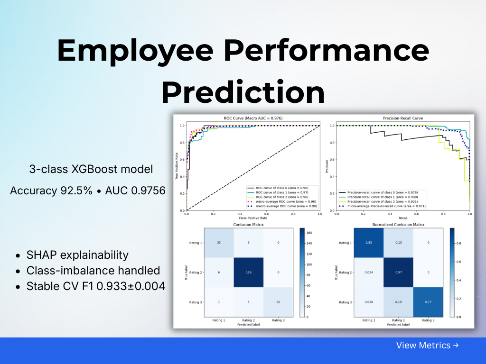
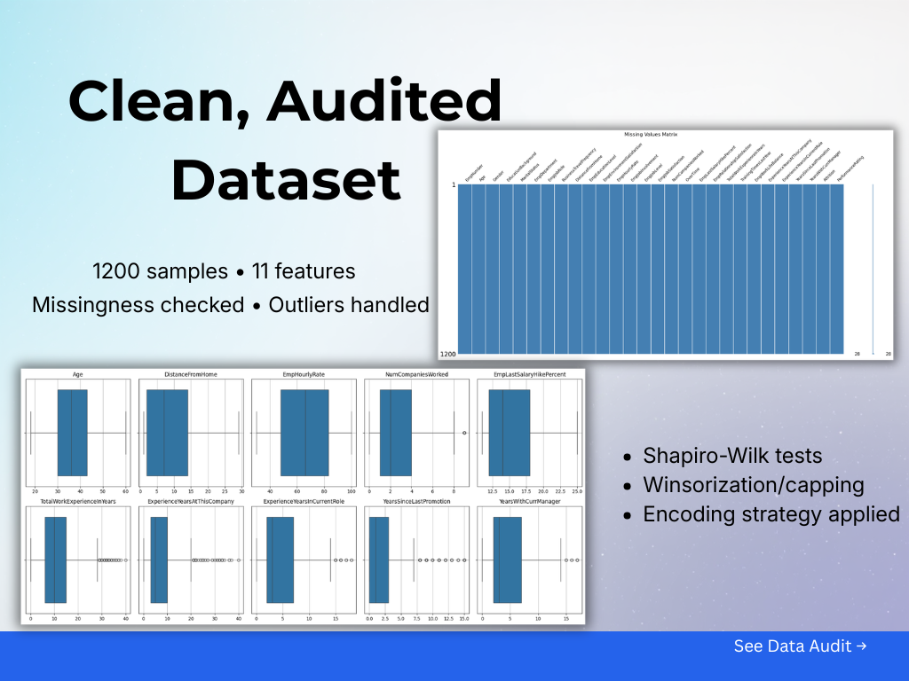
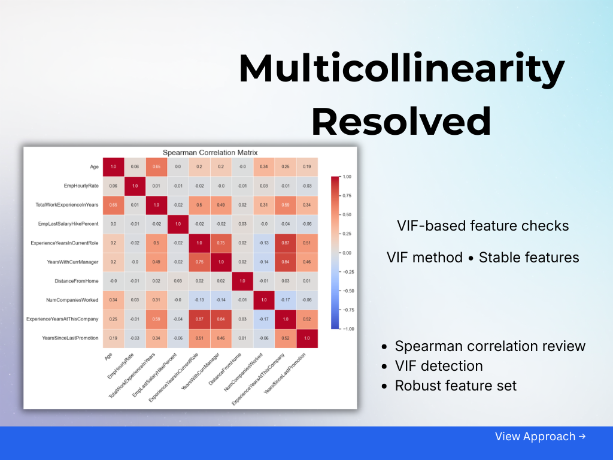
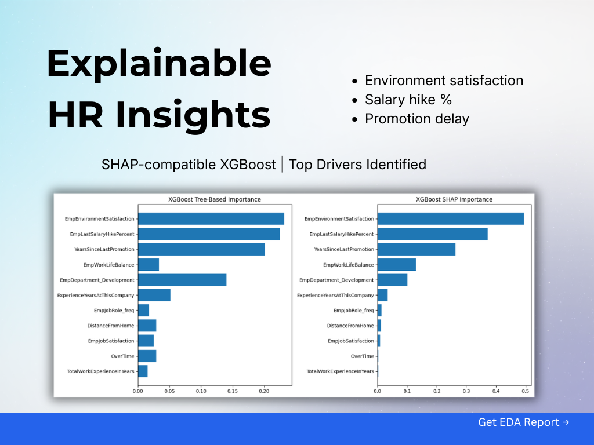
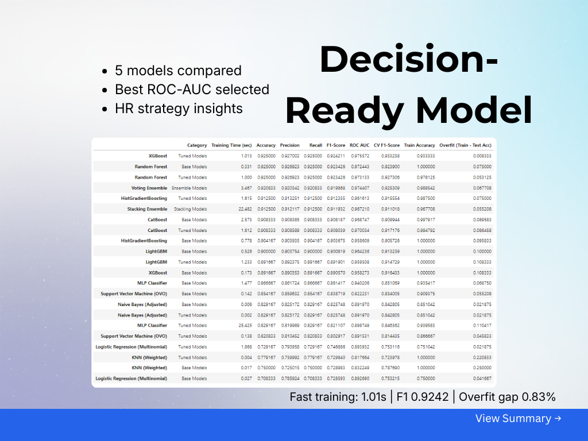

<div align="center">

      

# Employee Performance Analysis for INX Future Inc.

Machine learning multiclass classification model for predicting employee performance ratings. Achieves 92.5% test accuracy and 93.3% cross-validation F1-score with XGBoost.

**Project Code:** 10281 | **Document Code:** CDS_Project_2_INX_Future_Emp_Data_V1.6

</div>

---

## Overview

Analyzes employee performance for INX Future Inc., a data analytics and automation solutions provider facing declining employee performance. Predicts performance ratings from 11 key features including environment satisfaction, salary hikes, and promotion history.

**Final Model:** XGBoost Classifier (multiclass)

- Test: Accuracy = 92.5%, F1-Score = 92.42%, ROC AUC = 0.976
- Cross-validation: F1-Score = 93.32% +/- 0.39%
- Features: 11 predictors (satisfaction scores, tenure, compensation)
- Overfitting gap: 0.83%
- Class weights: {0: 2.065, 1: 0.458, 2: 3.019} for imbalance handling

See [reports/Analysis/](reports/Analysis/) for detailed business insights and recommendations.

---

## Quick Start

<p align="center">
  
</p>

<p align="center">
  
</p>

<p align="center">
  
</p>

<p align="center">
  
</p>

<p align="center">
  
</p>

### Installation

```bash
pip install -r requirements.txt
```

### Load Trained Model

```python
import joblib
model = joblib.load('models/XGBClassifier_model_multiclass.pkl')

# Predict performance ratings (0=Low, 1=Average, 2=Outstanding)
predictions = model.predict(X_new)  # Requires 11 engineered features
```

### Run Full Pipeline

Execute notebooks in sequence:
1. `notebooks/data_exploratory_analysis.ipynb` - EDA and feature engineering
2. `notebooks/data_processing.ipynb` - Encoding and dataset preparation
3. `notebooks/train_model.ipynb` - Model training and evaluation
4. `notebooks/predict_model.ipynb` - Inference on new data

## Dataset

| Property | Details |
|----------|---------|
| **Source** | INX Future Inc. Employee Database |
| **Samples** | 1,200 employees |
| **Features** | 28 attributes (27 predictors + PerformanceRating target) |
| **Final Features** | 11 selected via importance analysis |
| **Split** | 960 train / 240 test (stratified, random_state=42) |
| **Classes** | 3 ratings (Low: 16.15%, Average: 72.92%, Outstanding: 10.94%) |

See [data/raw/Data dictionaries.md](data/raw/Data%20dictionaries.md) for full feature descriptions.

## Project Structure

**Core directories:**
- `data/raw/` - Original dataset (INX_Future_Inc_Employee_Performance_CDS_Project2_Data_V1.8.xls)
- `data/processed/` - Train/test splits (X_train.csv, X_test.csv, y_train.csv, y_test.csv, prepared_data.csv)
- `notebooks/` - Sequential analysis pipeline (4 notebooks)
- `src/` - Reusable modules (statistical_analysis.py, model_evaluation.py, utils.py)
- `models/` - Trained model (XGBClassifier_model_multiclass.pkl)
- `reports/Analysis/` - Business insights and recommendations
- `results/figures/` - Visualizations and plots

## Working with the Notebooks

**Import pattern used:**
The notebooks import functions from src/ modules using:
```python
from src.utils import memory_usage, dataframe_memory_usage, garbage_collection
from src.statistical_analysis import normality_test_with_skew_kurt, spearman_correlation, calculate_vif
from src.model_evaluation import evaluate_model, mean_absolute_shap, cross_validation_analysis_table, plot_multiclass_evaluation
```

**Pipeline execution order:**
1. **data_exploratory_analysis.ipynb** - EDA, outlier treatment, multicollinearity detection, feature engineering
2. **data_processing.ipynb** - Encoding strategies, feature selection, dataset preparation
3. **train_model.ipynb** - Model comparison, hyperparameter tuning, SHAP analysis
4. **predict_model.ipynb** - Model inference and evaluation

## Model Training Workflow

**Base model evaluation:**
```python
from src.model_evaluation import evaluate_model

metrics = evaluate_model(model, X_train, y_train, X_test, y_test)
# Returns: Accuracy, Precision, Recall, F1-Score, ROC AUC, CV F1, Train Accuracy, Overfit Score, Training Time
```

**Cross-validation analysis:**
```python
from src.model_evaluation import cross_validation_analysis_table

cv_results = cross_validation_analysis_table(
    model=model,
    X_train=X_train,
    y_train=y_train,
    cv_folds=5,
    scoring_metric='f1_weighted'
)
```

**Multiclass evaluation plots:**
```python
from src.model_evaluation import plot_multiclass_evaluation

plot_multiclass_evaluation(
    model=model,
    X_test=X_test,
    y_test=y_test,
    class_labels=['Low', 'Average', 'Outstanding']
)
# Generates: ROC curve, Precision-Recall curve, Confusion matrices
```

## Statistical Analysis Functions

**Normality testing:**
```python
from src.statistical_analysis import normality_test_with_skew_kurt

normal_df, not_normal_df = normality_test_with_skew_kurt(df)
# Uses Shapiro-Wilk (n<=5000) or Kolmogorov-Smirnov (n>5000)
# Returns DataFrames with p-values, statistics, skewness, kurtosis
```

**Multicollinearity detection:**
```python
from src.statistical_analysis import calculate_vif

vif_data, high_vif_features = calculate_vif(
    data=df,
    exclude_target='PerformanceRating',
    multicollinearity_threshold=5.0
)
# Returns VIF scores and features exceeding threshold
```

**Spearman correlation:**
```python
from src.statistical_analysis import spearman_correlation

corr_matrix = spearman_correlation(
    data=df,
    non_normal_cols=['col1', 'col2'],
    exclude_target='PerformanceRating',
    multicollinearity_threshold=0.8
)
# Generates correlation heatmap and identifies multicollinear pairs
```

## Model Persistence

**Loading the final model:**
```python
import joblib

# Load trained XGBoost model
model = joblib.load('models/XGBClassifier_model_multiclass.pkl')

# Make predictions (requires 11 features in correct order)
predictions = model.predict(X_new)

# Get probability scores
probabilities = model.predict_proba(X_new)
```

**Required features for inference (in order):**
1. EmpLastSalaryHikePercent
2. EmpEnvironmentSatisfaction
3. YearsSinceLastPromotion
4. ExperienceYearsAtThisCompany
5. EmpDepartment_Development
6. EmpJobRole_freq
7. EmpWorkLifeBalance
8. OverTime
9. EmpJobSatisfaction
10. TotalWorkExperienceInYears
11. DistanceFromHome

## Key Findings

### Department-Wise Performance
| Department | % Excellent/Outstanding | Attrition Rate |
|-----------|------------------------|----------------|
| Development & Data Science | 96.4% | 5.1% |
| Sales | 76.7% | 18.6% |
| Finance | 69.4% | 15.3% |

**Analysis:**
- Development teams show higher performance with frequent promotions (>20% salary hikes)
- Sales/Finance departments show low satisfaction (40-50% "Low" scores) and longer promotion gaps (3.7 years average)

### Top 3 Performance Drivers (SHAP Analysis)
1. **EmpEnvironmentSatisfaction** (SHAP: 0.4945)
   - Low satisfaction employees 3x more likely to underperform
2. **EmpLastSalaryHikePercent** (SHAP: 0.372)
   - Employees with <15% hikes show 40% lower performance
3. **YearsSinceLastPromotion** (SHAP: 0.2631)
   - Delays >3 years lead to 35% lower performance

## Model Comparison

### Top Models After Hyperparameter Tuning
| Model | Accuracy | F1-Score | ROC AUC | Training Time | Overfit | CV F1 |
|-------|----------|----------|---------|---------------|---------|-------|
| XGBoost | 92.50% | 92.42% | 0.9756 | 1.013s | 0.0083 | 0.9332 |
| Random Forest | 92.50% | 92.34% | 0.9731 | 1.000s | 0.0531 | 0.9273 |
| HistGradientBoosting | 91.25% | 91.24% | 0.9616 | 1.615s | 0.0750 | 0.9156 |
| CatBoost | 90.83% | 90.80% | 0.9700 | 1.612s | 0.0865 | 0.9172 |
| LightGBM | 89.17% | 89.19% | 0.9595 | 1.233s | 0.1083 | 0.9147 |

### XGBoost Class-Wise Performance
| Rating | Precision | Recall | F1-Score |
|--------|-----------|--------|----------|
| Low (0) | 82% | 85% | 84% |
| Average (1) | 94% | 97% | 95% |
| Outstanding (2) | 100% | 77% | 87% |

**Why XGBoost was selected:**
- Minimal overfitting (0.83% gap vs 5.31% for Random Forest)
- Highest ROC AUC (0.9756) and CV F1 stability (93.32% +/- 0.39%)
- Fast training (1.013s) with strong generalization
- SHAP explainability for business insights

## Key Design Decisions

**Feature engineering:**
- YearsSinceFirstJob = Age - EducationYears (based on education level mapping)
- TotalCompensation = EmpHourlyRate * 2080 (annual working hours)

**Outlier treatment:**
- Winsorization at 95th percentile: TotalWorkExperienceInYears, ExperienceYearsAtThisCompany
- Domain-informed capping: YearsSinceLastPromotion (10), NumCompaniesWorked (8)

**Encoding strategies:**
- One-hot encoding (cardinality <= 6): Gender, MaritalStatus, EmpDepartment, etc.
- Frequency encoding (cardinality > 6): EmpJobRole
- Ordinal encoding: Satisfaction scores (1-4), EmpEducationLevel
- Binary encoding: OverTime, Attrition

**Multicollinearity resolution:**
- Dropped 4 features: Age (VIF=23.3), EmpHourlyRate, ExperienceYearsInCurrentRole (r=0.87), YearsWithCurrManager


## Reports

Detailed analysis in `reports/Analysis/`:

- [Employee Performance Analysis Report for INX Future Inc..md](reports/Analysis/Employee%20Performance%20Analysis%20Report%20for%20INX%20Future%20Inc.md) - Full methodology and results
- [Top 3 Factors Affecting Employee Performance.md](reports/Analysis/Top%203%20Factors%20Affecting%20Employee%20Performance.md) - SHAP analysis and insights
- [Department-Wise Performance Analysis.md](reports/Analysis/Department-Wise%20Performance%20Analysis.md) - Departmental comparisons
- [Employee Performance Prediction Model.md](reports/Analysis/Employee%20Performance%20Prediction%20Model.md) - Model development details
- [Recommendations to Improve Employee Performance at INX Future Inc..md](reports/Analysis/Recommendations%20to%20Improve%20Employee%20Performance%20at%20INX%20Future%20Inc..md) - Strategic recommendations
- [GALLERY.md](results/figures/GALLERY.md) - Visualizations (44 figures)

## Development

### Code Quality

```bash
# Install development dependencies
pip install -r requirements-dev.txt

# Setup pre-commit hooks
pre-commit install

# Format code
black .
isort .

# Lint code
flake8 .

# Format notebooks
nbqa black notebooks/

# Run all pre-commit checks
pre-commit run --all-files
```

### Pre-commit Hooks

Configuration (`.pre-commit-config.yaml`):
- black (88-char lines)
- isort (black-compatible)
- nbqa-black (notebooks)
- Validation (YAML, trailing whitespace, file size checks)

### Configuration Files
- `.flake8`: Max line length 88, max complexity 10, numpy docstring convention
- `pyproject.toml`: Black and isort settings (line length 88, Black profile)

---

MIT License - Copyright (c) 2025 Dhanesh B. B.
